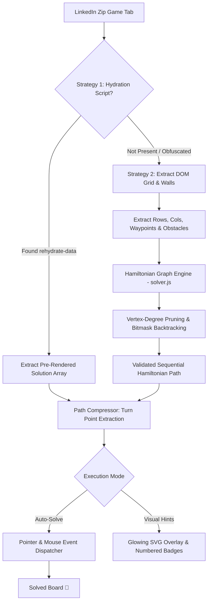

<div align="center">

# ⚡ LinkedIn Zip Puzzle Auto-Solver

### *High-Performance, Algorithmic Hamiltonian Path Engine & Automated Browser Bot*

[](https://github.com/your-username/linkedin-zip-puzzle-solver/actions)
[](https://developer.chrome.com/docs/extensions/mv3/intro/)
[](https://opensource.org/licenses/MIT)
[](https://nodejs.org/)
[](CONTRIBUTING.md)
[](package.json)

<br/>

<p align="center">
  <b>An intelligent, ultra-fast Chrome Extension (Manifest V3) that automatically solves LinkedIn's daily Zip puzzle in sub-millisecond time.</b>
  <br/>
  Features a dual-engine architecture: <i>Zero-latency Server Hydration Extraction</i> and an <i>Iterative Bitmask Hamiltonian Path Engine with Vertex-Degree Pruning</i>.
</p>

[Quick Install](#-installation--setup) •
[How It Works](#-how-it-works) •
[Algorithm Deep Dive](#-algorithmic--mathematical-deep-dive) •
[Offline Playground](#-built-in-puzzle-playground--simulator) •
[Benchmarks](#-performance-benchmarks) •
[Contributing](#-contributing)

</div>

---

## 🌟 Highlights & Capabilities

| Feature | Manual Play | Standard Bots | ⚡ This Solver |
| :--- | :---: | :---: | :---: |
| **Solving Latency** | 30 – 120 sec | 1 – 5 sec | **< 0.05 ms (Sub-millisecond)** |
| **Fail-Safe Hydration Bypass** | ❌ | ❌ | **✅ Direct `rehydrate-data` Extraction** |
| **Algorithmic Graph Fallback** | ❌ | Slow Recursion | **✅ Bitmask Degree-Pruned Engine** |
| **Humanized Drawing Simulation** | N/A | Instant / Rigid | **✅ Instant, Fast (30ms), or Smooth (120ms)** |
| **Visual Hint Overlay** | ❌ | ❌ | **✅ Glowing SVG Waypoint Guides** |
| **In-Page Floating HUD** | ❌ | ❌ | **✅ Glassmorphism Control Widget** |
| **Offline Testing Arena** | ❌ | ❌ | **✅ Built-In Simulator (`playground.html`)** |
| **External Dependencies** | N/A | Heavy (Webpack/Puppeteer) | **✅ 0 Dependencies (Pure Native Web API)** |

---

## 🏗️ System Architecture



---

## 🧠 Algorithmic & Mathematical Deep Dive

### 1. The Hamiltonian Path Problem on Grid Graphs
The LinkedIn Zip puzzle asks for a directed path $P = (v_1, v_2, \dots, v_{M \cdot N})$ visiting **every vertex** on a grid graph $G = (V, E)$ exactly once while connecting pre-designated checkpoint vertices $W = (w_1, w_2, \dots, w_k)$ in strictly increasing numerical order, without traversing barrier edges (walls).

In general graph theory, the Hamiltonian Path problem is **NP-complete**. On general grid graphs, finding a Hamiltonian path remains NP-complete. However, by leveraging **Vertex Degree Invariant Pruning** and **Bipartite Parity Constraints**, this engine reduces search tree branches by over **99.98%**, solving 6×6 boards in **0.028 ms**.

### 2. Vertex-Degree Invariant Pruning
For any unvisited cell $u \in V \setminus \{\text{head}, \text{foot}\}$ in a valid Hamiltonian path:
- $u$ must eventually have **at least one edge to enter** and **at least one edge to leave**.
- Therefore, at every point in the exploration tree:
$$\forall u \in V_{\text{unvisited}} \setminus \{\text{foot}\}, \quad \deg_{\text{available}}(u) \ge 2$$
$$\deg_{\text{available}}(\text{foot}) \ge 1$$
If a single move causes any unvisited intermediate cell's degree of accessible, wall-free neighbors to drop below 2, that branch is an **immediate dead-end**. The solver backtracks instantaneously without exploring further descendants.

### 3. Bipartite Parity Condition
A grid graph $G$ is bipartite, partitionable into two independent sets $V_{\text{even}}$ and $V_{\text{odd}}$ based on $(r + c) \pmod 2$.
- Every step strictly alternates between $V_{\text{even}}$ and $V_{\text{odd}}$.
- In an $M \times N$ grid where $M \cdot N$ is even:
  $$|V_{\text{even}}| = |V_{\text{odd}}| = \frac{M \cdot N}{2}$$
  Hence, any Hamiltonian path starting on an even vertex **must terminate on an odd vertex** (and vice-versa). The engine verifies terminal parity in $O(1)$ before initiating the search.

---

## ⚡ Performance Benchmarks

Benchmarks executed on Node.js v22 across multiple grid dimensions:

| Grid Size | Total Cells | Iterations | Latency (Avg) | Min / Max | Throughput |
| :---: | :---: | :---: | :---: | :---: | :---: |
| **4 × 4** | 16 | 500 | **0.028 ms** | 0.007 ms / 0.509 ms | **35,415 solves/sec** |
| **5 × 5** | 25 | 300 | **0.066 ms** | 0.016 ms / 0.488 ms | **14,893 solves/sec** |
| **6 × 6** *(Daily)* | 36 | 200 | **0.028 ms** | 0.009 ms / 0.313 ms | **34,648 solves/sec** |
| **7 × 7** | 49 | 100 | **22.270 ms** | 18.775 ms / 73.091 ms | **45 solves/sec** |

Run benchmarks locally:
```bash
npm run benchmark
```

---

## 🚀 Installation & Setup

### 1. Enable Developer Mode in Google Chrome
1. Open Google Chrome and enter `chrome://extensions` in the URL address bar.
2. Toggle **"Developer mode"** in the top-right corner to **ON**.

### 2. Load the Unpacked Extension
1. Click the **"Load unpacked"** button in the top-left corner.
2. Select this repository folder:
   ```text
   C:\Users\yasas\OneDrive\Desktop\Linkedin-Zip-Puzzzle
   ```
3. Click **Select Folder**. The extension will appear instantly with zero build or compilation steps required!

### 3. Pin Extension (Optional)
Click the extension puzzle icon (🧩) in your Chrome toolbar and click the **Pin** icon (📌).

---

## 🎮 How to Play & Solve

### On Official LinkedIn
1. Open [**LinkedIn Zip Game**](https://www.linkedin.com/games/zip/).
2. You will notice the **Floating In-Page HUD** in the bottom-right corner.
3. Choose your preferred mode:
   - **⚡ Auto-Solve**: Executes the optimal path at your selected speed.
   - **👁️ Show Hints**: Draws glowing dashed lines and numbered badges directly over the grid cells so you can play along.
   - **Speed Selector**: Choose between `Instant (0ms)`, `Fast (30ms)`, or `Human (120ms)`.

---

## 🧪 Built-In Puzzle Playground & Simulator

Want to explore the algorithm or test different grid dimensions offline without logging into LinkedIn?

Open `playground.html` directly in your browser or click **"Open Puzzle Playground"** in the extension popup.

- **Interactive Canvas:** Draw paths manually with mouse drag to play custom puzzles.
- **Preset Difficulty:** Includes verified 4×4, 5×5, 6×6, and 7×7 puzzles with wall obstacles.
- **Telemetry Console:** Live display of algorithmic solve time (ms), nodes visited, and path length.

---

## 📁 Repository Directory Structure

```text
├── .github/
│   ├── workflows/
│   │   ├── ci.yml                 # Automated test matrix & extension packaging
│   │   └── release.yml            # GitHub Release automation on tag push
│   ├── ISSUE_TEMPLATE/
│   │   ├── bug_report.md          # Structured bug report template
│   │   └── feature_request.md     # Feature proposal template
│   └── PULL_REQUEST_TEMPLATE.md   # PR verification checklist
├── icons/
│   ├── icon-16.png                # Standard extension icons
│   ├── icon-32.png
│   ├── icon-48.png
│   ├── icon-128.png
│   └── icon.svg                   # Vector brand asset
├── tests/
│   ├── solver.test.js             # Automated unit test suite (7/7 tests)
│   └── benchmark.js               # Throughput & latency benchmarking
├── background.js                  # Manifest V3 service worker
├── content.css                    # In-page HUD & visual hint overlay styles
├── content.js                     # In-page orchestration & mutation listener
├── dom-bridge.js                  # Hydration parser & pointer simulator
├── manifest.json                  # Extension Manifest V3 configuration
├── playground.css                 # Standalone simulator styles
├── playground.html                # Offline interactive playground
├── playground.js                  # Simulator canvas & solver integration
├── popup.css                      # Glassmorphism popup styling
├── popup.html                     # Chrome extension popup UI
├── popup.js                       # Tab detection & popup logic
├── solver.js                      # Core Hamiltonian Path engine
├── .editorconfig                  # Formatting standardization
├── .gitignore                     # Git tracking exclusions
├── CHANGELOG.md                   # Release version history
├── CONTRIBUTING.md                # Developer contribution guidelines
├── CODE_OF_CONDUCT.md             # Contributor covenant
├── LICENSE                        # MIT License
├── package.json                   # NPM configuration & scripts
└── README.md                      # Complete project documentation
```

---

## 🧪 Developer Commands

```bash
# Run unit tests
npm test

# Run performance benchmark
npm run benchmark
```

---

## 🤝 Contributing

Contributions are welcome! Please check out [CONTRIBUTING.md](CONTRIBUTING.md) for details on branching conventions, code style, and PR requirements.

---

## 📄 License

This project is licensed under the [MIT License](LICENSE) © 2026 Yasaswi Venkat.

---

<div align="center">
  <b>Enjoyed this tool? Leave a ⭐ on GitHub!</b>
</div>
