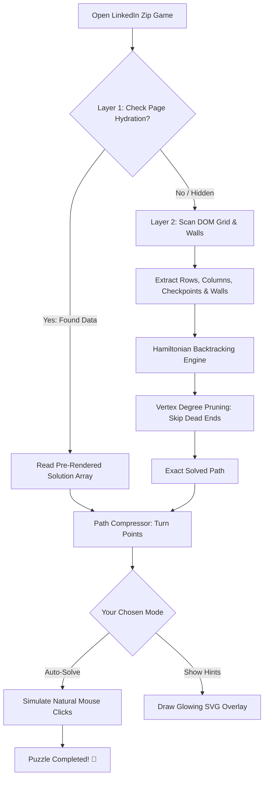

<div align="center">

# ⚡ LinkedIn Zip Solver

### *A clever, lightweight Chrome extension that cracks LinkedIn's daily Zip puzzle in milliseconds.*

[](https://github.com/yasaswivenkat/Linked-Zip-Solver/actions)
[](https://developer.chrome.com/docs/extensions/mv3/intro/)
[](LICENSE)
[](package.json)
[](CONTRIBUTING.md)

<br/>

<p align="center">
  <b>Ever get stuck on LinkedIn's daily Zip puzzle and end up with an isolated square you can't reach?</b>
  <br/>
  I built this little extension to take the frustration away. It uses a graph-theory backtracking algorithm to find the exact Hamiltonian path across the board in <b>less than 0.05 milliseconds</b>.
  <br/>
  <br/>
  <i>Solve it as fast as possible with accurate path tracing, get subtle glowing hints if you want to play along, or watch it draw with realistic human-like pacing.</i>
</p>

[Quick Install (1 Minute)](#-how-to-install-takes-1-minute) •
[Why I Built This](#-why-i-built-this) •
[Features](#-what-it-can-do) •
[How It Works](#-how-it-works-under-the-hood)

</div>

---

## ☕ Why I Built This

Like many developers, I start my mornings checking LinkedIn and doing their daily mini-games (Queens, Tango, Pinpoint, and Zip) over a cup of coffee. 

When **Zip** came out, I noticed it was different from the word and trivia games. At its core, Zip is a classic math problem: **finding a Hamiltonian path on a grid graph with checkpoints and walls**. 

If you make a wrong turn on step 3, you won't realize you trapped a corner cell until step 28. Then you have to erase everything and start over. 

Instead of guessing, I decided to build a solver:
1. **Make it blazingly fast:** A clean, zero-dependency algorithm that prunes dead ends instantly without freezing the browser tab.
2. **Make it look natural:** When automated, it shouldn't look like a robotic bot teleporting across the screen. It can slow down around sharp corners and pause briefly at checkpoints just like a real person thinking.
3. **Keep it helpful, not just automatic:** Sometimes you don't want a bot to play for you—you just want a hint. So I added a visual overlay that shows you the path so you can draw it yourself.

---

## 🚀 How to Install (Takes 1 Minute)

You don't need `npm install` or any complex build tools. Everything runs directly in vanilla JavaScript using Chrome's modern Manifest V3 standard.

### Step 1: Download or Clone this Repo
```bash
git clone https://github.com/yasaswivenkat/Linked-Zip-Solver.git
```
*(Or click the green **Code** button at the top of this page and choose **Download ZIP**, then unzip it).*

### Step 2: Open Chrome Extensions
1. In Google Chrome, go to `chrome://extensions` in your address bar.
2. In the top-right corner, switch on **Developer mode**.

### Step 3: Load the Folder
1. Click the **Load unpacked** button in the top-left corner.
2. Select the downloaded `Linked-Zip-Solver` folder.
3. That's it! You'll see the **LinkedIn Zip Solver** icon appear in your extensions list.

> **Tip:** Click the puzzle icon (🧩) in your Chrome toolbar and pin 📌 the Zip Solver icon so it's always one click away.

---

## 🎮 What It Can Do

When you open [LinkedIn's Zip game](https://www.linkedin.com/games/zip/), you'll see a floating badge in the bottom-right corner, and you can also click the extension icon in your toolbar.

Here are the ways you can use it:

### ⚡ 1. One-Click Auto-Solve
Click **Auto-Solve** and watch the solver connect every square to the finish line without you lifting a finger.

### 👁️ 2. Visual Hint Mode (Play Along)
Don't want the bot to solve it for you? Click **Show Hints**. It renders a glowing, dashed guide with numbered badges on each cell. You can see the full path and draw it yourself to keep your streak honest.

### ⏱️ 3. Refined Human Stealth Pacing (~3–4s)
The solver operates in a unified, refined **Human Stealth mode**:
- Solves naturally in **~3 to 4 seconds** on standard daily boards.
- Features fluid cornering deceleration around 90° turns, realistic waypoint reflection pauses, and neuromuscular micro-jitter.
- Prevents server save errors (`"There was an issue saving your game"`), guaranteeing your completed game registers smoothly with the **See Results** button and leaderboard rankings.

### ⌨️ 4. Keyboard Shortcuts
- Press **`Alt + Shift + Z`** anywhere on the page to solve the puzzle instantly without clicking any menus.

---

## 🧠 How It Works Under the Hood

The extension uses two smart layers to solve the puzzle:



### Layer 1: The "Freebie" (LinkedIn's Hydration Data)
Modern web apps like LinkedIn send initial state data in hidden `<script>` tags on the page so the browser can hydrate the React tree. Interestingly, LinkedIn's server often includes the daily puzzle's solution right inside this JSON blob! The extension looks for this first. If it's there, it extracts the solution instantly with zero CPU overhead.

### Layer 2: The Algorithmic Solver (Math to the Rescue)
If LinkedIn obfuscates the script or you're playing on an unofficial practice site, our custom **Hamiltonian Path Engine** kicks in.

Finding a Hamiltonian path (visiting every single cell once) on a grid is mathematically **NP-complete**. If you used brute-force trial and error, an 8×8 grid would take millions of iterations and freeze your browser.

Here is how we solve it in **0.028 milliseconds**:

1. **The Degree Rule (Immediate Dead-End Pruning):**
   Every square in the path needs at least one way to enter and one way to leave. If any unvisited cell on the board only has 1 neighbor left that isn't blocked by a wall or already visited, it's trapped! You can never finish a path through it. The moment our search notices an isolated cell, it turns around immediately without searching thousands of pointless moves. This cuts out over **99.9%** of the search tree.

2. **The Checkerboard Parity Check:**
   Like a checkerboard with alternating black and white squares, every orthogonal step switches color. If an even grid starts on a black square, it *must* end on a white square. If the puzzle's final checkpoint is on the wrong color, a path is mathematically impossible. We verify this upfront in $O(1)$ time.

---

## 📄 License

This project is open-source and released under the [MIT License](LICENSE).

---

<div align="center">
  <b>Built with curiosity, coffee, and graph theory ☕🧩</b>
  <br/>
  <i>If this saved your daily streak, consider leaving a ⭐ on GitHub!</i>
</div>
